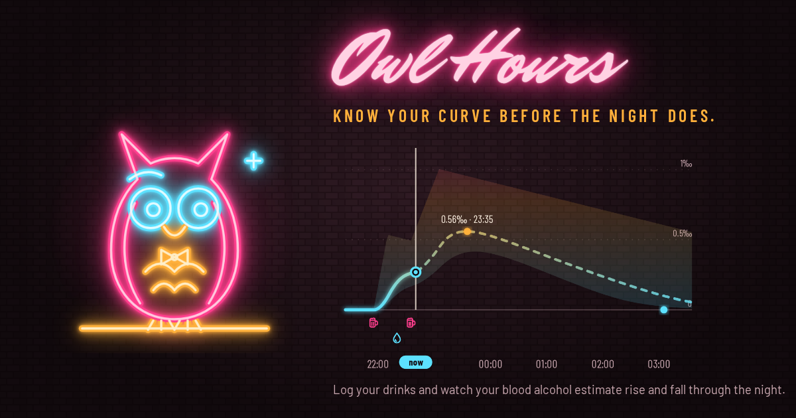
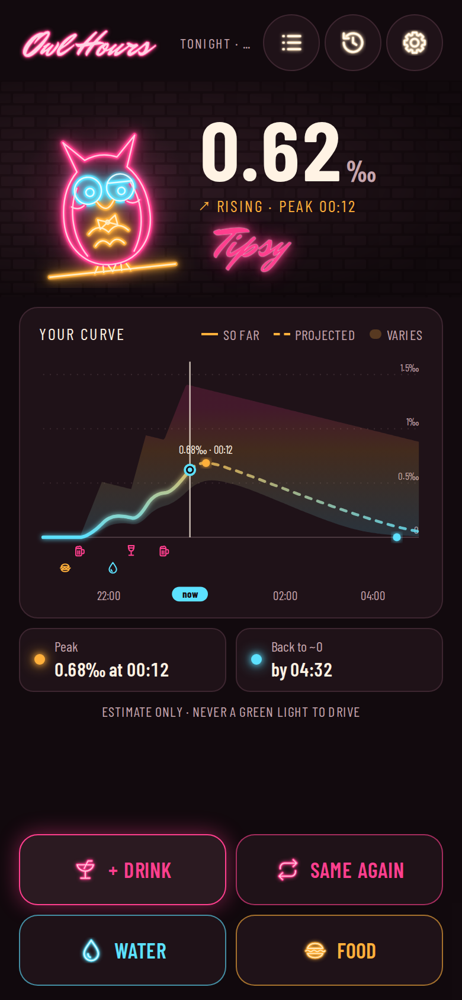
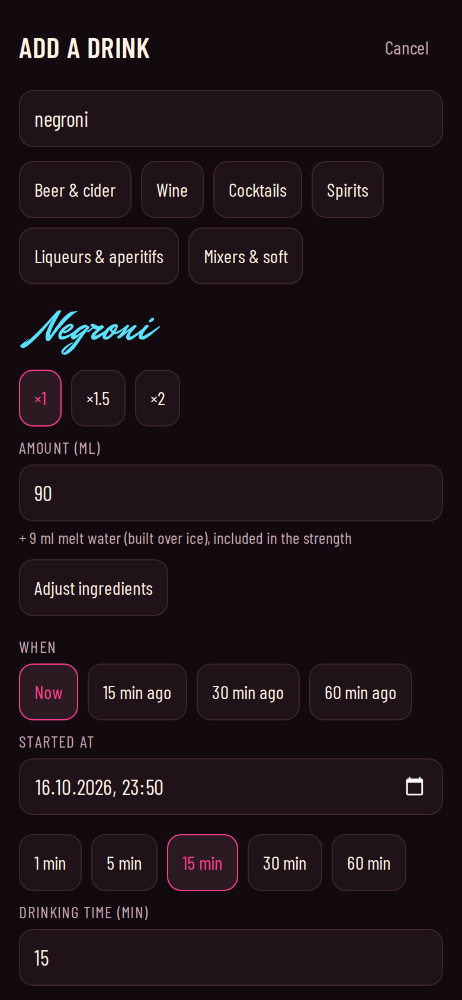
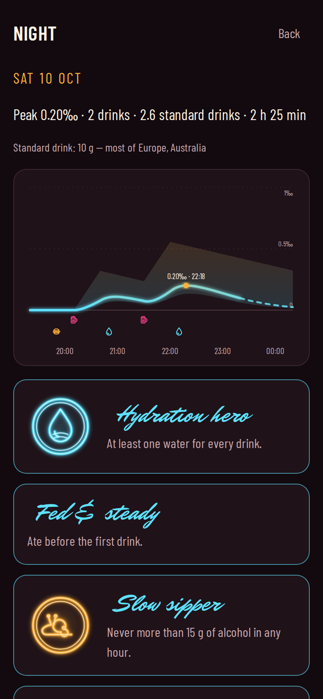
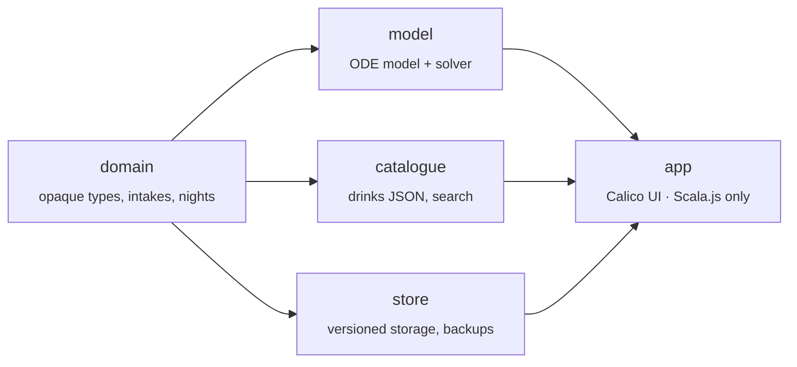

<p align="center">
  
</p>

<p align="center">
  <b>Know your curve before the night does.</b><br>
  An offline PWA that estimates your blood alcohol over a night out, written in Scala 3 with
  <a href="https://armanbilge.github.io/calico/">Calico</a> and <a href="https://www.scala-js.org/">Scala.js</a>.
</p>

<p align="center">
  <a href="https://owlhours.app/"><b>Open the app</b></a> ·
  <a href="https://github.com/luksow/owl-hours/actions/workflows/ci.yml"></a>
</p>

> [!WARNING]
> Estimates only. Never use this app to decide whether you can drive.

<p align="center">
  
  &nbsp;
  
  &nbsp;
  
</p>

## What it does

- **Log as you go.** About 260 sourced drinks (beers, wines, spirits and cocktails, with their recipes), plus water and food, each with a start time and drinking time.
- **See the whole night.** The curve so far, where it is heading, how much it can vary, your peak and when you are back to about zero.
- **Watt reacts.** A hand-bent neon owl whose look follows your estimate.
- **Look back.** Past nights with their curves, and badges for healthy habits only: water with every drink, eating first, sipping slowly. No badge rewards drinking more.
- **Yours alone.** No account and no server: everything stays in your browser, works offline, and installs to your home screen.

The estimate comes from the physiologically based alcohol model by Podéus, Cedersund et al. (Linköping University), ported to Scala and checked against curves from the authors' own Python code.

## How it is built

Owl Hours was written to learn Calico, so the whole app is Scala: no JavaScript framework, and only a few lines of JavaScript, in [`web/main.js`](web/main.js), to bridge the service worker and the install prompt.



Every module except `app` is cross-built for the JVM and JavaScript, and their tests run on both.

### Calico: the UI as Cats Effect resources

[Calico](https://armanbilge.github.io/calico/) renders HTML from `Resource[IO, HtmlElement[IO]]` values and updates them from fs2 `Signal`s, with no virtual DOM and no diffing. In this app:

- **One state, many signals.** [`AppState`](modules/app/src/main/scala/owlhours/app/AppState.scala) holds the saved data in a `SignallingRef`. The clock is an fs2 stream that ticks every 30 seconds, and once more when the phone wakes. The route is the stream of `hashchange` events, held as a `Signal`.
- **Screens are resources.** The current screen is a `Signal[IO, Resource[IO, HtmlElement[IO]]]`. When the route changes, Calico releases the old screen (its listeners and fibers) and acquires the new one:

  ```scala
  val screen = (app.catalogue, onboarded, app.route).mapN {
    case (CatalogueState.Ready(c), true, Route.Tonight) => TonightScreen(app, c)
    case (CatalogueState.Ready(_), true, Route.History) => HistoryScreen(app)
    // …
  }
  div(cls := "min-h-dvh bg-wall", problemsBanner(app), div(screen), UpdateToast(), UndoBar(app))
  ```

- **Expensive work runs once per change.** Projecting a night runs a simulation up to 36 hours long. [`TonightScreen`](modules/app/src/main/scala/owlhours/app/ui/TonightScreen.scala) derives it with `discrete.changes.holdResource`, so it reruns when you log something, not on every clock tick, and all of the screen's views share the result.
- **Neon is SVG.** Calico has no SVG tags, so Watt, the chart and the badges are built as escaped markup in plain Scala and mounted by a 10-line custom `Modifier`, [`InnerHtml`](modules/app/src/main/scala/owlhours/app/ui/InnerHtml.scala). It renders the first value at once and the rest from a background fiber.
- **Saves never race.** Changes go through a Cats Effect `Mutex`, so a slow save can never overwrite a newer state. Undo keeps a snapshot, and a fiber hides the undo bar after 8 seconds.

### Scala.js: one codebase, two runtimes

- **The model runs everywhere.** The alcohol model and its adaptive Dormand–Prince solver are plain Scala. The same golden-curve tests, generated from the authors' Python, pass on the JVM and on Node.
- **Small enough for a phone.** The main bundle is about 346 KB gzipped, and the build fails over 400 KB. [`scala-java-time`](https://github.com/cquiroz/scala-java-time) was about 9% of it, so Scala.js gets its own small `java.time`. It has the same API as the JDK's, and the same tests check both.
- **Built by Vite.** [`@scala-js/vite-plugin-scalajs`](https://github.com/scala-js/vite-plugin-scalajs) imports the linked Scala.js output like any module. Tailwind 4 styles it, and vite-plugin-pwa (Workbox) precaches the app for offline use.
- **Browser APIs from Scala.** `fs2.dom` turns DOM events into streams, `scalajs-dom` covers `fetch` and storage, and `js.Dynamic` reaches the small JavaScript bridge.
- **Tested in a real browser.** Playwright runs the built app in Chromium, including install prompts, offline loads and a build under `/owl-hours/`, and Lighthouse CI checks it on every push.

## Develop

- `sbt test` — Scala tests on the JVM and Node (domain, model, catalogue, store, app logic)
- `sbt scalafmtAll` — formats the Scala code (braces only: `-no-indent` makes indentation-based blocks a compile error); CI runs `scalafmtCheckAll`
- `cd web && npm install` once, then:
  - `npm run dev` with `sbt ~app/fastLinkJS` in a second terminal — live development
  - `npm run build && npm run preview` — production build (fails if the main bundle is over 400 KB gzipped) on http://localhost:4173
  - `npm run test:e2e` — Playwright end-to-end tests (run `npx playwright install chromium` once)
  - `npm run test:e2e:subpath` — the same app built under `/owl-hours/`, as GitHub Pages serves it
  - `npm run assets` — re-render the icons, favicon, social preview and iOS launch images after changing `public/icon.svg`, `public/owl.svg` or `brand/`
  - `npm run screens` — re-take the README screenshots from the built app
  - `npm run lighthouse` — Lighthouse CI on `dist/` (needs Chrome: ``CHROME_PATH="$(node -e 'import("@playwright/test").then(m => console.log(m.chromium.executablePath()))')" npm run lighthouse``)
- `cd reference && uv run python run_scenarios.py` — regenerate golden curves from the authors' Python model

CI (`.github/workflows/ci.yml`) runs all of the above on pushes to `main`, on pull requests and on demand. Deploys to GitHub Pages run from `main` once the repository variable `OH_DEPLOY` is `true`.

## Your data

Everything stays in the browser on your device. Settings → Your data exports a backup file and imports one; "Delete all data" removes everything Owl Hours stored.

## Licence

Apache-2.0. The ported model keeps its authors' MIT notice ([`reference/LICENSE-alcohol-model.md`](reference/LICENSE-alcohol-model.md)).
